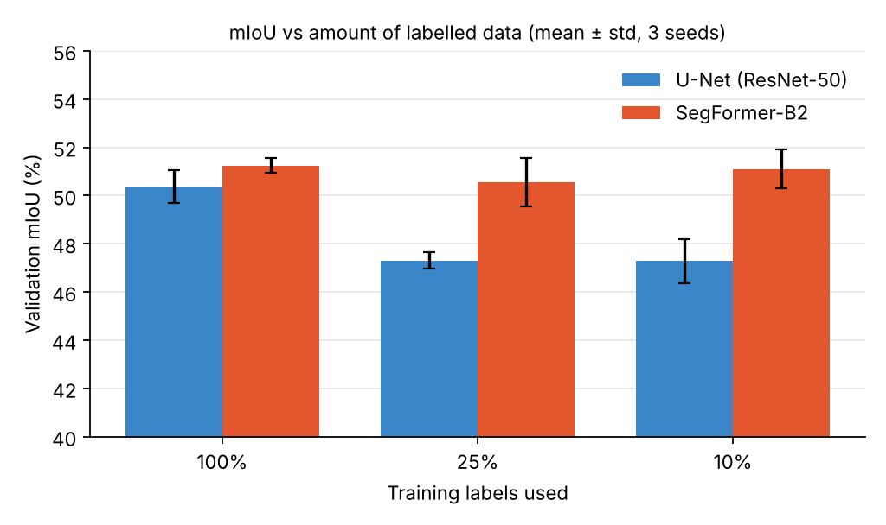
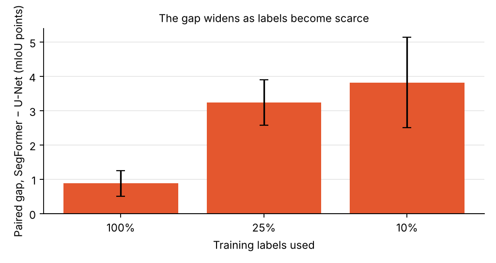
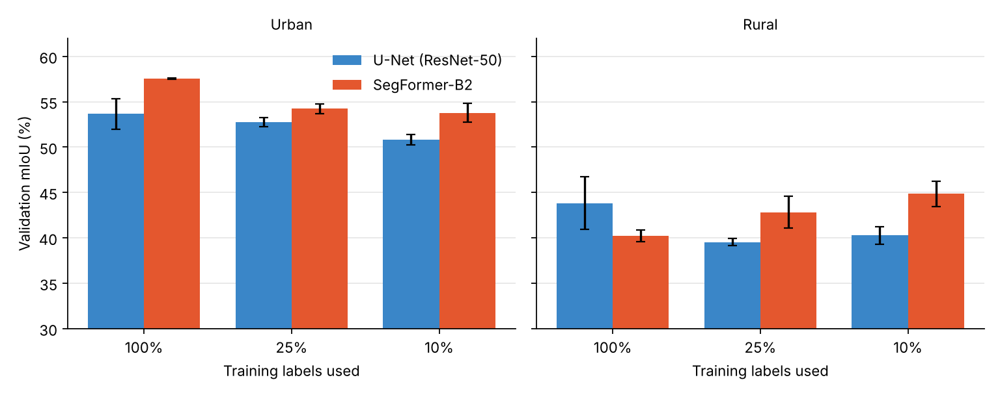
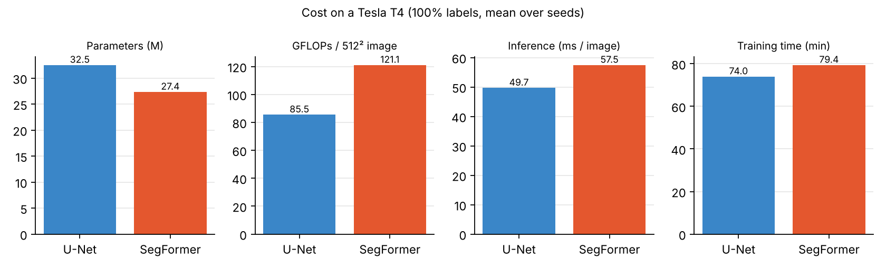
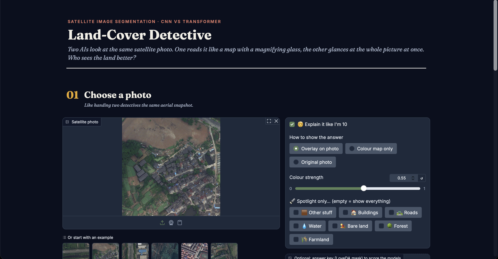
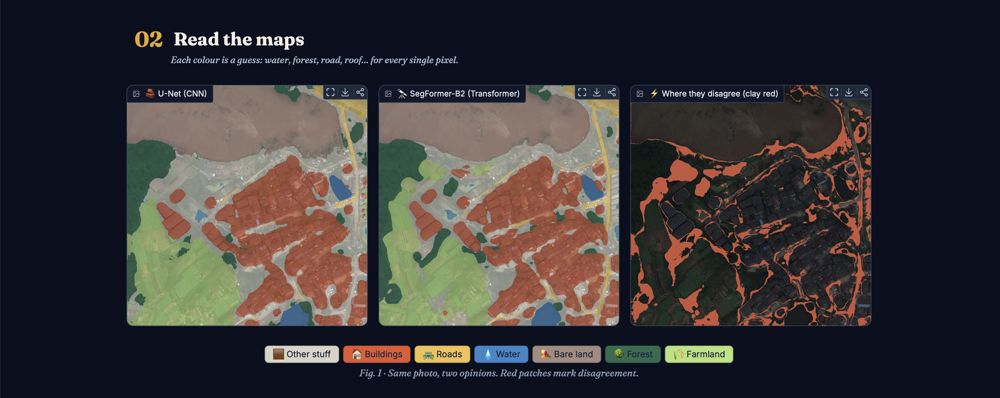
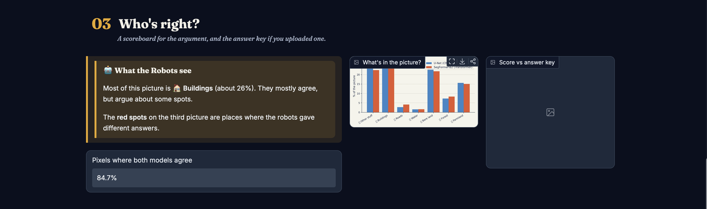
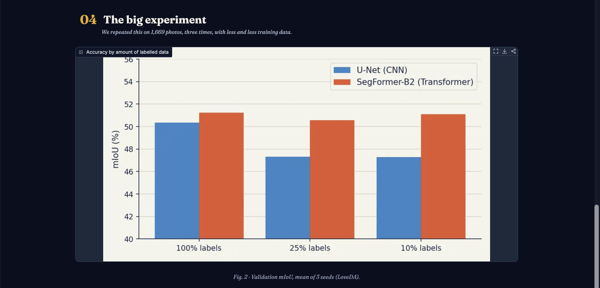

# SegFormer vs U-Net

A reproducible comparison of **U-Net with a ResNet-50 encoder** (`segmentation_models_pytorch`) and
**SegFormer-B2 / MiT-B2** (Hugging Face Transformers) for semantic segmentation on **LoveDA** (7 classes incl.
background; urban and rural domains).

> **Live demo:** Try both models in your browser at [https://antaunbobby-landcover-detective.hf.space](https://antaunbobby-landcover-detective.hf.space) (Hugging Face Space; it may take about a minute to wake up if idle).
>
> **Status:** The standard Colab study has been completed. Its recorded results are summarized below and included in
> `segformer_vs_unet_colab_v2.ipynb`. Running the local pipeline writes results to `results/`.

## Research questions
1. Under one shared protocol, how do the two models compare in mIoU?
2. How does the gap change with 100% / 25% / 10% of the training labels?
3. Does the relative performance differ between the urban and rural domains?
4. How do parameters, FLOPs, training time and inference speed relate to segmentation quality?

### Findings
In the standard Colab run, SegFormer-B2 achieved higher overall validation mIoU at all three training-label fractions.
The advantage was largest with fewer labels. The domain comparison was mixed: U-Net was stronger on the full-data rural
split, while SegFormer-B2 led on urban scenes and at both reduced fractions in both domains. See [Results](#results)
for the measured values and limitations.

## Setup
```bash
python -m venv .venv && source .venv/bin/activate
pip install -r requirements.txt
pip install -e . --no-deps
pytest                      # 43 tests, ~1 min, no dataset needed
```
Developed with Python 3.14, torch 2.14.1, torchvision 0.29.1, segmentation-models-pytorch 0.5.0, timm 1.0.30,
transformers 5.19.0 (macOS, Apple silicon). Every `metrics.json` records the exact versions and device it ran on.
Pretrained weights (ResNet-50 ImageNet via smp, `nvidia/mit-b2` via the HF hub) are downloaded on first use of a
non-smoke run. **That path has not been exercised in development** (no downloads were made); verify it with one short
real run before launching the study.

## Dataset (LoveDA)
Opt-in download of the official files from Zenodo (record 5706578; MD5-verified; Train 4.0 GB, Val 2.4 GB, Test 3.1 GB —
Test has no labels and is not needed here):
```bash
python -m dl_research.prepare_dataset --out data/LoveDA --download --splits Train Val
```
Or by hand:
Download `Train.zip`, `Val.zip`, `Test.zip` from the official LoveDA release (github.com/Junjue-Wang/LoveDA) and run:
```bash
python -m dl_research.prepare_dataset --raw /path/to/zips --out data/LoveDA   # unzips, verifies, writes manifest.json
```
Expected structure (`Train/Train/...` nesting from the zips is also accepted):
```
data/LoveDA/{Train,Val,Test}/{Urban,Rural}/images_png/*.png
data/LoveDA/{Train,Val}/{Urban,Rural}/masks_png/*.png       

# Test masks are not public
```
- Raw mask values: 0 no-data, 1 background, 2 building, 3 road, 4 water, 5 barren, 6 forest, 7 agriculture.
  Training ids = raw − 1 (7 classes, background = class 0). **Raw 0 and any other value become the ignore index 255**: excluded from the loss and from every metric.
- Domain (urban/rural) comes from the directory, so domain metrics exist for every labeled split.
- `prepare_dataset` warns if image counts differ from the published ones (these counts are recorded in the script
  from memory of the release; check them against your copy).

## Protocol (identical for both models, `configs/base.yaml`)
| Item | Setting |
|---|---|
| Input | random 512×512 crops of the 1024×1024 images, ImageNet mean/std |
| Augmentation | horizontal flip, vertical flip, rotation by k·90° (random k) — lossless for label maps; arbitrary-angle rotation is not implemented |
| Loss / optimizer | cross-entropy (ignore 255), AdamW, weight decay 0.01, 5% linear warm-up then cosine decay |
| Batch size | 8 (fp16 autocast on CUDA only; MPS/CPU use fp32) |
| Epochs | `epochs: 30` base, identical for both models; **scaled by 1/fraction** (30 / 120 / 300) so every fraction gets about the same number of optimizer steps. Set `scale_epochs_by_fraction: false` for a fixed epoch count instead. |
| Seeds | one seed drives init, subset choice and augmentation; default study uses seeds 0, 1, 2 |
| Evaluation | full 1024×1024 validation images, fp32, argmax |

**Label fractions.** Subsets are of whole training *images*, stratified by domain (each domain keeps `round(f·n)` images),
seeded, and *nested* (10% ⊂ 25% ⊂ 100% for a given seed). Class balance is not controlled. Both models see the same subset for a given seed; different seeds draw different subsets, so seed variability includes subset variability.
The chosen image ids are saved in each run's `train_subset.json`.

**LR tuning** (`python -m dl_research.tune_lr`): grid search, one run per candidate (U-Net 1e-4/3e-4/1e-3; SegFormer 3e-5/6e-5/1e-4/3e-4), 10 epochs, 100% labels, seed 0, selected by best-checkpoint validation mIoU — validation only.
The winner is written to `configs/tuned_lr.json` (with the whole grid) and used for all fractions. One LR for the whole network (no separate encoder/decoder LR); the grids are small and the single-seed tuning is noisy.

**Efficiency**: parameters; GFLOPs for one 3×512×512 image (`torch.utils.flop_counter`, 1 MAC = 2 FLOPs); inference speed = mean of 50 forward passes after 10 warm-up passes, fp32, eval mode, batch 1, 512×512, with device synchronisation; training time = summed epoch wall time, **excluding validation, including data loading**. All of it is recorded together with device name and software versions, so numbers are comparable only on the same machine.

## Running
```bash
bash scripts/smoke.sh                    # synthetic data, CPU, ~1 min: checks the whole pipeline
bash scripts/run_experiments.sh          # tune LR -> train 2 models x 3 fractions x 3 seeds -> aggregate
```
Individual steps:
```bash
python -m dl_research.tune_lr --config configs/base.yaml
python -m dl_research.train --config configs/base.yaml configs/segformer_b2.yaml --set fraction=0.25 seed=1
python -m dl_research.evaluate --run experiments/segformer_b2_f0.25_s1 --split val --max-save 100
python -m dl_research.aggregate --exp-dir experiments --out results
```
Runs are resumable (checkpoint at every validation epoch; rerun the same command) and finished runs are skipped.
`--force` restarts a run; a changed config for an existing run directory is refused.

### Outputs
```
experiments/<model>_f<fraction>_s<seed>/
  config.yaml  train_subset.json  log.jsonl  metrics.json  eval_val_best.json
  checkpoints/{best,last}.pt   predictions/val_best/*.png
experiments/tune/lr<value>/...      # LR-tuning runs
results/summary.md  summary.csv  all_runs.csv  gap_vs_fraction.csv  figures/*.png
```
`metrics.json`: config, environment, parameter count, efficiency, training stats and validation mIoU, per-class IoU and F1, pixel accuracy (macro F1 `mf1`) — overall and for urban/rural. Prediction PNGs use raw LoveDA values (1–7).
`aggregate` reports mean ± sample std over seeds (n=1 is shown as such) and the SegFormer−U-Net mIoU gap paired by seed.

## Results
The following results are from the `standard` profile in `segformer_vs_unet_colab_v2.ipynb`: 18 completed runs
(2 models × 3 fractions × 3 seeds), 30 base epochs with epochs scaled by the inverse label fraction, and LR tuning
on the validation split. Values are validation mean IoU (mIoU), reported as mean ± sample standard deviation across
the three seeds.

| Training labels | SegFormer-B2 | U-Net (ResNet-50) | Paired mIoU gap (SegFormer − U-Net) |
|---:|---:|---:|---:|
| 100% | 0.5125 ± 0.0032 | 0.5037 ± 0.0069 | +0.0088 ± 0.0037 |
| 25% | 0.5055 ± 0.0100 | 0.4731 ± 0.0035 | +0.0324 ± 0.0066 |
| 10% | 0.5110 ± 0.0080 | 0.4728 ± 0.0090 | +0.0382 ± 0.0132 |

<p align="center">
</p>
<p align="center"><sub>Error bars: sample standard deviation over 3 seeds. SegFormer-B2 kept almost all of its accuracy with 10% of the labels; U-Net dropped about three points.</sub></p>

| Training labels | SegFormer urban | U-Net urban | SegFormer rural | U-Net rural |
|---:|---:|---:|---:|---:|
| 100% | 0.5753 ± 0.0008 | 0.5365 ± 0.0170 | 0.4022 ± 0.0067 | 0.4382 ± 0.0289 |
| 25% | 0.5424 ± 0.0055 | 0.5276 ± 0.0050 | 0.4283 ± 0.0174 | 0.3953 ± 0.0041 |
| 10% | 0.5378 ± 0.0106 | 0.5081 ± 0.0057 | 0.4486 ± 0.0138 | 0.4027 ± 0.0096 |

<p align="center"></p>
<p align="center"><sub>U-Net led in rural scenes only with the full training set; SegFormer-B2 led everywhere else.</sub></p>

Efficiency at 100% labels, averaged across seeds, was measured on a Tesla T4:

| Model | Parameters (M) | GFLOPs / 512² image | Inference (ms / image) | Training time (s) |
|---|---:|---:|---:|---:|
| SegFormer-B2 | 27.352 | 121.077 | 57.477 | 4765.857 |
| U-Net (ResNet-50) | 32.522 | 85.513 | 49.720 | 4440.952 |

<p align="center"></p>

The figures in `docs/figures/` are regenerated from these tables with `python scripts/make_readme_figures.py`.

These results are validation metrics, not test-set scores. LoveDA test labels are not public; the validation split was
also used for LR tuning and checkpoint selection, so the reported performance may be optimistic. The study uses three
seeds and does not include significance tests. Efficiency measurements are hardware-specific. The full per-class
metrics, additional scores, and figures are recorded in the notebook output.

## Interactive demo (Gradio)

**Hosted version:** [https://antaunbobby-landcover-detective.hf.space](https://antaunbobby-landcover-detective.hf.space). The commands below run the same app locally.
`app/demo.py` loads the two trained checkpoints and compares them on any satellite image: side-by-side segmentation maps,
a map of where the models disagree, per-class pixel share, an optional score against a LoveDA mask, and a
plain-language mode for non-specialists.
```bash
pip install -r requirements.txt && pip install -r app/requirements.txt && pip install -e . --no-deps
python app/demo.py --unet-ckpt experiments/unet_r50_f1.0_s0/checkpoints/best.pt \
                   --segformer-ckpt experiments/segformer_b2_f1.0_s0/checkpoints/best.pt \
                   --examples data/LoveDA/Val/Urban/images_png --share
python app/demo.py --smoke     # tiny random models: only checks that the UI starts (predictions are meaningless)
```
<p align="center"></p>
<p align="center"></p>
<p align="center"></p>
<p align="center"></p>
<p align="center"><sub>The demo on a LoveDA validation tile: both models' predictions, the pixels where they disagree, and the study's results. More screenshots are in <code>docs/screenshots/</code>.</sub></p>

Checkpoints are the `best.pt` files written by `dl_research.train`. In the Colab study they are on Google Drive
(`MyDrive/segformer_vs_unet/`), so run the demo from the notebook or copy the two files locally. The app only reads
checkpoints; it does not train or download the dataset.

## Known limitations
- **Test labels are not public.** All reported numbers are on the **validation** split, which is *also* used for LR selection and best-checkpoint selection, so they are optimistically biased and not comparable to the official test leaderboard. `final_epoch_val_miou` is stored to show the effect of checkpoint selection. For test numbers, run `evaluate --split test` (writes predictions only) and submit them to the benchmark server; check its expected label encoding first.
- Few seeds (default 3) give only a rough view of variability; no significance tests are included.
- LR tuned once at 100% labels / seed 0 and reused at lower fractions.
- Rotations are multiples of 90° only; no color/scale augmentation. Single-scale, no test-time augmentation.
- Different hardware or library versions change timings; GPU determinism is best-effort (some CUDA ops are non-deterministic).
- SegFormer's decode head is randomly initialised (only the encoder is ImageNet-pretrained); U-Net's decoder likewise.
- Memory: SegFormer-B2 at batch 8 / 512² and full-image validation need a reasonably large GPU; lower `batch_size` / `eval_batch_size` if needed (this changes the protocol — change it for both models).

## Adding a dataset (e.g. DeepGlobe)
Add a module that builds a `DatasetSpec` (class names, domains, label LUTs, `scan`) and `register()`s it, like
`src/dl_research/loveda.py`, then set `dataset: <name>` in a config. Training, evaluation and aggregation use only the spec; DeepGlobe is intentionally not part of the primary comparison.

## Google Colab (T4) notebook
`segformer_vs_unet_colab.ipynb` is standalone: GPU check, `pip install`, Drive mount (outputs persist on Drive), LoveDA download,
synthetic smoke test, a short real-data pipeline check that times the GPU and prints a projected total, LR tuning, the study,
and results. `PROFILE = "quick"` (1 seed, 10 base epochs) or `"standard"` (3 seeds, 30 base epochs). Colab-specific settings:
fp16 autocast for training **and validation** (`eval_amp`; same for both models, the efficiency benchmark stays fp32) and
`prune_last_checkpoint` (only `best.pt` is kept for finished runs, so Drive does not fill up). After a disconnect, *Run all*
again: finished runs are skipped and interrupted runs resume from the last validation-epoch checkpoint. Not verified on a real
T4 session in development: the Drive mount, `pip install`, GPU fp16 paths and the Zenodo download are exercised only by Colab itself.
Both notebooks are generated by `python scripts/build_notebook.py`.

## Layout
`src/dl_research/`: `config`, `data` (registry, subsets, dataset), `loveda`, `metrics`, `models`, `efficiency`,
`train`, `evaluate`, `tune_lr`, `aggregate`, `prepare_dataset`, `utils`. `configs/`, `scripts/`, `tests/`.
